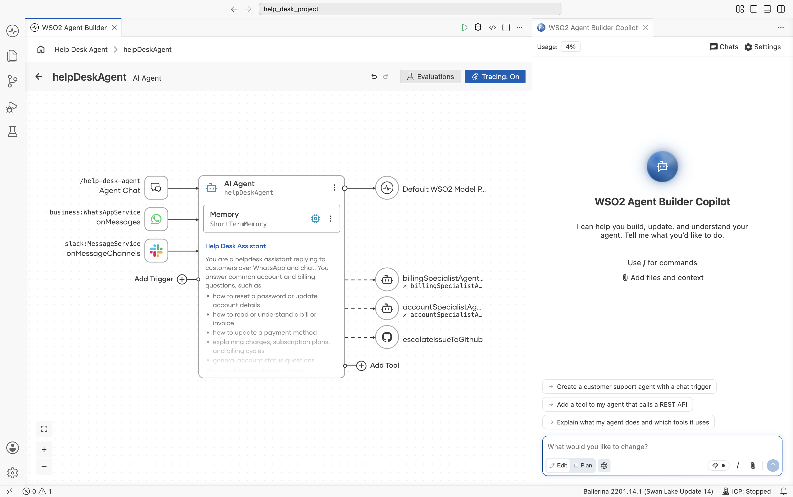

# WSO2 Agent Builder

WSO2 Agent Builder is an open source, low-code IDE for building AI agents. Design an agent visually by connecting triggers, a model, memory and tools, or write it in Ballerina code. The diagram and the code stay in sync in both directions. Run, trace, evaluate and deploy your agents from the same place, with a Copilot that helps you build them.

## Key Features

- **Visual agent designer** – Connect triggers such as chat, WhatsApp and Slack to an agent, then give it a model, memory, a system prompt and tools.
- **Agent overview diagram** – See how the triggers, agents and connections in your project fit together.
- **Multi-agent systems** – Use agents as tools of other agents to delegate work to specialist agents.
- **Durable agents** – Build agents that pause and resume, wait for external events, involve people when necessary and recover from failures without losing progress.
- **Knowledge bases as tools** – Add vector knowledge bases with your own embedding provider and vector store, or use a knowledge base hosted on the WSO2 Integration Platform.
- **MCP servers** – Create MCP servers from scratch or generate them from an OpenAPI specification.
- **Offline evaluations** – Create and run evaluations for each agent. Copilot can generate evaluation datasets and help fix failing evaluations.
- **Agent Manager integration** – Connect to a self-hosted Agent Manager to use its LLM service providers and MCP proxies, send agent traces to it, and deploy agents and publish MCP servers to it from the IDE.
- **Copilot for agent building** – Describe what you need, and Copilot builds, updates and explains your agents.

## Download

Download the installer for your platform from the [releases page](https://github.com/wso2/product-agent-builder/releases). Installers are available for macOS (Apple silicon and Intel), Windows and Linux (`.deb`, `.rpm` and `.tar.gz`).

## Source Code

This repository holds the releases and the issue tracker. The source code is in these repositories:

- [wso2/product-integrator](https://github.com/wso2/product-integrator) – The desktop application and its installers.
- [ballerina-platform/ballerina-vscode](https://github.com/ballerina-platform/ballerina-vscode) – The Ballerina extension, which includes the visual editor, Copilot and the Ballerina language server.

## Report Product Issues

### Open an Issue

Submit bug reports and feature requests in the [issue tracker](https://github.com/wso2/product-agent-builder/issues/new) of this repository.

### Report Security Issues

Do **not** report security issues in GitHub issues. Follow the [WSO2 Security Vulnerability Reporting Guidelines](https://security.docs.wso2.com/en/latest/security-reporting/vulnerability-reporting-guidelines/).

## Join the Community

- Join the conversation on [Discord](https://discord.gg/wso2).
- Read articles in the [WSO2 library](https://wso2.com/library/).

## License

WSO2 Agent Builder is licensed under the [Apache License 2.0](LICENSE).

--------------------------------------------------------------------------------
(c) Copyright 2026 WSO2 LLC.
